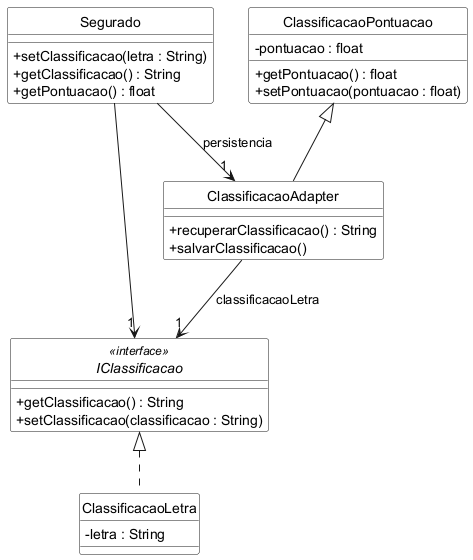

# Adapter

Trabalho da disciplina Aspectos Avançados em Engenharia de Software.

Exemplo do padrão Adapter em Java, com testes em JUnit 5. O tema é o mesmo da
seguradora usada nos trabalhos anteriores: na tela, o segurado recebe uma
classificação de risco por letra (A, B, C ou D), mas o sistema da seguradora
guarda essa classificação como uma pontuação de 0 a 1000.

O `ClassificacaoAdapter` faz a conversão entre os dois formatos. Quando a letra
é salva, ele transforma em pontuação (A = 900, B = 700, C = 500 e D = 0), e
quando a classificação é consultada, ele transforma a pontuação de volta em
letra. Assim as duas partes conversam sem precisar mudar nenhuma delas.

## Diagrama de classes

